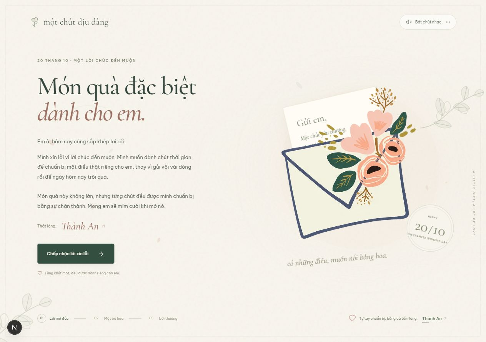
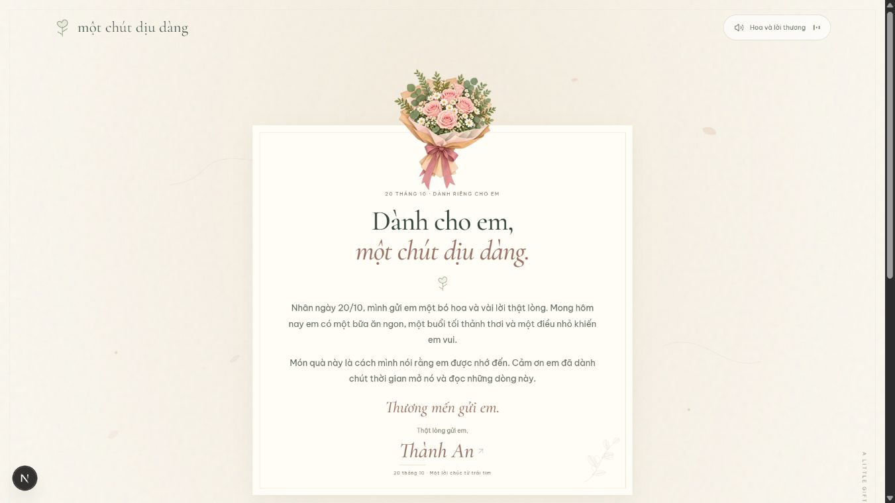
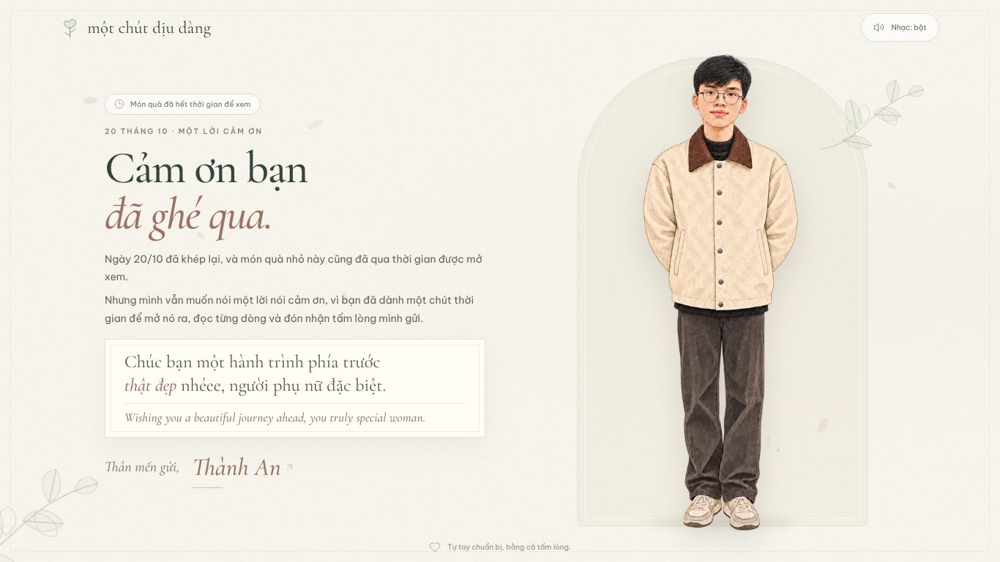
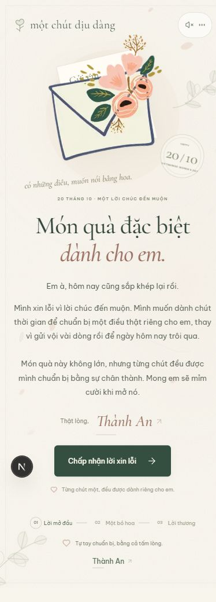
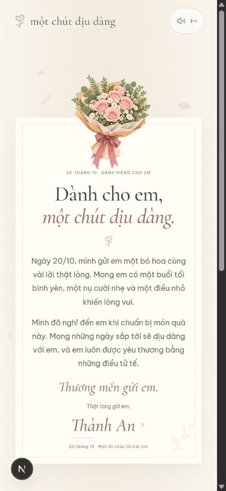

# Một chút dịu dàng · 20/10

Website quà tặng 20/10 bằng tiếng Việt: một lời xin lỗi đến muộn, một chàng trai trao hoa, một tấm thiệp và một chỗ để người nhận gửi lời nhắn lại. Sau hạn xem, mọi đường dẫn tự chuyển sang một trang cảm ơn.

Dự án cá nhân, làm bằng Next.js. Không có SQL, ORM, tracker hay dịch vụ AI trong lúc chạy.

| Mở đầu | Trao hoa | Lời chúc |
| --- | --- | --- |
|  |  |  |

| Trang cảm ơn | Trên điện thoại |
| --- | --- |
|  |    |

## Tính năng

- **Ba cảnh nối tiếp:** lời mở đầu, trao hoa, thiệp chúc. Có cánh hoa rơi, nét gió ở nền và tôn trọng tùy chọn `prefers-reduced-motion`.
- **Nhân vật chuyển động:** ảnh minh họa nhiều lớp, tay nâng bó hoa nhẹ nhàng, lá và hoa đung đưa, mắt chớp ngẫu nhiên.
- **Bốn tấm thiệp:** dành cho mẹ, em, em gái, chị, mỗi người một cách xưng hô và lời chúc riêng.
- **Nhạc nền:** hai đoạn piano không lời tự tổng hợp, chuyển bài khi nhận hoa, có nút tắt/bật. Trình duyệt chặn tự phát thì nhạc bắt đầu sau lần chạm đầu tiên.
- **Lời nhắn lại:** người nhận gửi lời nhắn, người gửi đọc trong hộp thư riêng `/letters` (có mật khẩu, xuất được JSON).
- **Hạn xem:** quá hạn, trang quà tự chuyển sang `/thanks`. Việc kiểm tra chạy trên server nên không bỏ qua được từ trình duyệt.
- **Responsive:** thiệp và trang cảm ơn vừa một màn hình laptop, cuộn bình thường trên điện thoại.

## Công nghệ

Next.js 16 (App Router) · React 19 · TypeScript strict · Tailwind CSS 4 · Motion · Zod · Vercel Blob · font Cormorant Garamond và Be Vietnam Pro (cài từ package, không gọi Google Fonts).

## Chạy trên máy

Cần Node.js **22 trở lên**.

```sh
git clone https://github.com/thanhanDemon2003/20-10.git
cd 20-10
npm install
cp .env.example .env.local     # Windows PowerShell: Copy-Item .env.example .env.local
npm run dev
```

Mở `http://localhost:3000`. Sau khi sửa `.env.local`, hãy khởi động lại server.

### Biến môi trường

| Biến | Bắt buộc | Ý nghĩa |
| --- | --- | --- |
| `LETTERS_ADMIN_PASSWORD` | Có | Mật khẩu mở `/letters`, tối thiểu 12 ký tự |
| `ADMIN_SESSION_SECRET` | Có | Khóa ký cookie đăng nhập, tối thiểu 32 ký tự, người dùng không bao giờ phải gõ |
| `BLOB_READ_WRITE_TOKEN` | Chỉ khi deploy | Token của Vercel Blob store **private**. Để trống khi chạy local |

Giá trị trong `.env.example` chỉ là mẫu để thử trên máy. **Đổi sang giá trị riêng trước khi deploy.** Tạo khóa ngẫu nhiên:

```sh
node -e "console.log(require('node:crypto').randomBytes(32).toString('hex'))"
```

### Đường dẫn

| Đường dẫn | Nội dung |
| --- | --- |
| `/` hoặc `/?to=2` | Thiệp mặc định (xưng mình / em) |
| `/?to=1` · `/?to=3` · `/?to=4` | Thiệp cho mẹ · em gái · chị |
| `/20-10` | Trang chọn một trong bốn tấm thiệp, vẫn nhận `?to=N` |
| `/?open=true` (thêm vào bất kỳ đường dẫn quà nào) | Mở quà ngay cả khi đã quá hạn |
| `/thanks` | Trang cảm ơn, luôn mở được |
| `/letters` | Hộp thư riêng, cần mật khẩu |

Hạn xem quà là hết ngày 20/10/2026 (giờ Việt Nam), đặt trong `src/lib/gift-window.ts`. Quá hạn, `/` và `/20-10` chuyển sang `/thanks`. Thêm `?open=true` vào đường dẫn (ví dụ `/?to=1&open=true`) để vẫn mở được quà sau hạn; tham số này được giữ khi bấm sang các trang quà khác. Đây không phải bí mật, ai biết tham số đều mở được.

## Tùy chỉnh

- **Lời chúc và tên người gửi:** sửa `src/config/recipients.ts`. Đây là nơi duy nhất chứa nội dung riêng của từng người nhận và thông tin người gửi (`sender`). **Hãy đổi các mục này trước khi dùng cho bạn.**
- **Nội dung trang cảm ơn:** `src/components/20-10/ThanksPage.tsx`.
- **Hình minh họa:** nằm trong `public/images/`. Nhân vật là hình minh họa người gửi, bạn cần thay bằng hình của mình. Mí mắt là lớp SVG riêng, nếu thay ảnh thì chỉnh vị trí trong `BoyIllustration.tsx` và `ThanksPage.tsx`.
- **Nhạc:** `public/audio/20-10-piano.mp3` và `20-10-for-you.mp3`. Tạo lại bằng `node scripts/generate-piano.mjs` hoặc thay bằng MP3 bạn có quyền sử dụng.

## Lời nhắn được lưu ở đâu

Mỗi lời nhắn gồm `id`, `name`, `message`, `recipientId` và `createdAt`, trong một file JSON duy nhất.

- **Khi chạy local (`npm run dev`):** lưu ở `data/messages.json`, đã loại khỏi Git. Ghi bằng file khóa và đổi tên nguyên tử để không hỏng dữ liệu. Nếu tiến trình bị tắt đột ngột và để lại `data/messages.json.lock`, hãy dừng hết server rồi xóa riêng file `.lock`.
- **Khi chạy production:** lưu trong một **private Blob** của Vercel tại `20-10/messages.json`, ghi bằng ETag để các request đồng thời không đè nhau. Thiếu Blob thì API trả lỗi rõ ràng, không lưu tạm vào ổ đĩa.

## Triển khai lên Vercel

1. Đẩy mã nguồn lên GitHub rồi import vào Vercel (framework Next.js, Node.js 22 trở lên).
2. Trong **Storage**, tạo **Blob store quyền Private** và kết nối với project.
3. Thêm biến môi trường `BLOB_READ_WRITE_TOKEN` (Vercel thường tự thêm khi kết nối store), `LETTERS_ADMIN_PASSWORD` và `ADMIN_SESSION_SECRET` bằng giá trị riêng của bạn.
4. Deploy, rồi thử gửi một lời nhắn và đăng nhập `/letters` để chắc là dữ liệu còn sau khi redeploy.
5. Nên thêm rule trong **Vercel Firewall** để giới hạn thử mật khẩu tại `/api/admin/login`. Bộ giới hạn trong ứng dụng chỉ là lớp bổ sung.

## API và bảo mật

| API | Quyền | Chức năng |
| --- | --- | --- |
| `POST /api/messages` | Công khai, cùng origin | Gửi lời nhắn |
| `GET /api/messages` | Phiên quản trị | Đọc lời nhắn, mới nhất trước (`?download=1` để xuất JSON) |
| `POST /api/admin/login` | Cùng origin | Đăng nhập bằng mật khẩu |
| `POST /api/admin/logout` | Phiên quản trị | Đăng xuất |

- Server chuẩn hóa và kiểm tra dữ liệu bằng Zod: tên 2–50 ký tự, lời nhắn 1–1.000 ký tự, giới hạn kích thước body, có honeypot chống bot.
- Giới hạn tần suất ghi: tối đa 5 lời nhắn mỗi người nhận mỗi phút và 30 lời nhắn tổng mỗi phút. Không thu thập IP hay định danh trình duyệt.
- Cookie đăng nhập ký HMAC, sống 8 giờ, `HttpOnly`, `SameSite=Strict`, `Secure` ở production. Đổi mật khẩu hoặc `ADMIN_SESSION_SECRET` sẽ đăng xuất mọi phiên.
- API kiểm tra origin, trả `Cache-Control: private, no-store`, React hiển thị lời nhắn dưới dạng văn bản (không render HTML).
- Thiếu cấu hình quản trị hợp lệ thì từ chối đăng nhập, không có mật khẩu mặc định.

URL của thiệp là đường dẫn chia sẻ cá nhân, không phải cơ chế xác thực người nhận. Đừng đưa thư mục `data` ra public và đừng chuyển Blob sang public.

## Lệnh hữu ích

```sh
npm run dev         # chạy local
npm run build       # build production
npm start           # chạy bản build
npm run lint        # ESLint
npm run typecheck   # kiểm tra kiểu TypeScript
```

## Cấu trúc

```text
src/
  app/
    page.tsx            Trang quà (mặc định thiệp cho em)
    20-10/              Trang chọn thiệp và đường dẫn cũ
    thanks/             Trang cảm ơn
    letters/            Hộp thư riêng
    api/                Lời nhắn, đăng nhập, đăng xuất
  components/
    20-10/              Các cảnh, nhân vật, nhạc, form, trang cảm ơn
    letters/            Đăng nhập và danh sách lời nhắn
  config/recipients.ts  Nội dung các tấm thiệp và thông tin người gửi
  lib/                  Hạn xem, phiên đăng nhập, kiểm tra dữ liệu, lưu JSON
public/                 Hình minh họa và nhạc
scripts/                Tạo nhạc piano
```
